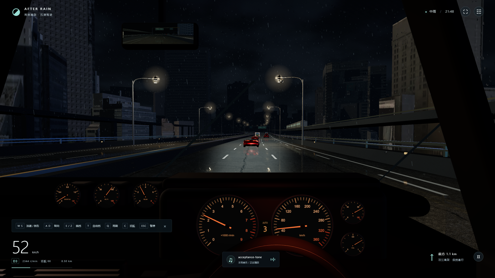

# AFTER RAIN · 雨夜高架 1.3.1

第一人称雨夜驾驶游戏。1.3 加入真实东京建筑立面与几何、外部车辆和灯具、连续弯道与起伏、多层高架；重做玻璃水珠聚合、粘滑、拖尾、气流拉伸与分裂，并增强电驱中段的科幻谐波。

1.3 已通过本机 1080p 高画质 10 分钟连续驾驶验收：平均 48.6 FPS，p95 27.7 ms。1.3.1 为声浪与纯演示录制修订，当前验收状态见下方文档。详见 [验收状态](docs/STATUS.md)。原创代码采用 [MIT](LICENSE)；第三方素材保留其原有许可，详见 [素材来源](ASSET-SOURCES.md)。



## 本地开发

需要 Node.js 22 或更新版本。

```sh
npm ci
npm run dev
```

打开终端显示的本地地址，点击“开始驾驶”或“巡航放松”。构建与动力检查：

```sh
npm run build
npm run verify:powertrain
```

## 一键启动

1. 完整解压便携包到一个可写文件夹。
2. 双击 **雨夜高架.exe**，等待 Chrome / Edge 游戏窗口打开。
3. 点击“开始驾驶”手动起步，或“巡航放松”自动行驶。
4. 建议佩戴耳机；F 全屏，H 隐藏屏幕界面，只看车内实体仪表。

保留启动器与 dist 文件夹的相对位置。玩家不需要 Node.js、开发工具或管理员权限。所有素材在本地，运行时不依赖素材网站；页面服务只监听 127.0.0.1。关闭游戏窗口后，服务约 90 秒无心跳会自动退出。

适用环境：Windows 10/11、较新 Chrome / Edge、硬件加速和 WebGL2。浏览器要求首次点击后才能播放声音。导航语音依赖本机中文语音组件。

## 操作

| 操作 | 按键 / 入口 |
|---|---|
| 油门 | W / ↑ |
| 制动 | S / ↓ / 空格 |
| 转向 | A、D / ←、→ |
| 自动 / 手动序列变速箱 | T；默认六挡自动 |
| 升挡 / 降挡 | E / Z；操作后进入手动模式 |
| 自适应巡航 | C；默认设定 68 km/h，可在设置中更改 |
| 雨刷 | Q；关闭 → 间歇 → 标准 → 快速 |
| 暂停 / 继续 | Esc / P 或暂停按钮 |
| 重新出发 | R 或设置 / 暂停菜单 |
| 音乐 | M 或底部音乐按钮 |
| 全屏 | F |
| 隐藏 / 显示屏幕界面 | H；车内仪表继续显示 |
| 转头 | 鼠标拖动前窗，松开回正 |
| 画质、雨量、音量、车流 | 右上角设置 |
| 播放自己的歌曲 | 设置 → 选择本地音乐，支持浏览器可解码的 MP3 / WAV 等 |

油门、制动或转向会接管巡航。手动驾驶没有人工车速上限；最大速度由扭矩、挡位、传动、轮胎半径和空气阻力自然决定。“68”是可调整的巡航设定值。发动机有转速红区，手动降挡会拒绝导致严重超转的操作。

测试高速时，可在设置中选择“封闭道路试驾 · 无车”。标准车流为 30 辆，少量为 10 辆。车辆没有损坏模型，碰撞采用柔性接触，适合体验，不代表专业模拟器的碰撞响应。

## 本版内容

- 真实城市资产：PLATEAU 千代田区 2025 年带纹理 LOD2 数据，选取 8 种城市块，布置 24 个实例；保留部分远景建筑补充天际线。实际建筑数据经过重排，本场景不对应真实东京道路。
- 路线按行驶距离积分：连续左右弯道、缓坡、第二层弯曲高架及桥墩；路面、护栏、灯杆、车流、车灯和后视镜跟随路线。主线持续可行驶；第二层道路是景观，暂不能驶入匝道。
- 25 辆详细 Car Concept 车模和 5 辆 Cesium Milk Truck；轿车使用同一基础车模，尚没有多品牌真实车型库。列车为本项目细化的 5 节车厢，增加门窗、转向架、车轮、车顶设备和前灯，车厢各自跟随弯曲轨道。
- 80 盏 PBR 外部灯具，搭配圆形锥杆和曲臂；CC0 沥青、法线和 HDR，暖色灯光与湿路反射。
- 水珠有质量、附着阈值和随机粘滑；邻域半径检测合并并保留动量。运动大滴留下水膜和残留小滴；高速气流逐渐向上、向两侧拉伸水滴并分裂大滴，水滴持续排出和补充。雨刷同步清除水珠和水膜，擦过后重新积水；水面高度梯度产生背景折射与灯光透镜变化。
- 默认纯电驱声浪随车速和负载变化，减弱中段重复拍频和过强的调频层，保留起步质感与高速升调。可独立切换涡轮六缸，具有燃烧脉冲、换挡断油和机械换挡声。两种模式分别发声，演示按片段剪辑展示；已移除高铁选项。
- 橙色实体指针仪表、右舵座舱、方向盘、导航、中控、后视镜；巡航、音乐、本地歌曲、音量、雨量、雨刷、画质与车流设置。

## 与参考视频的关系及限制

参考分析与原始文档链接见 **REFERENCE-TECHNIQUES.md**。视频未提供完整模组清单，本项目不宣称使用了它的具体滤镜、天气模组版本或车型。

建筑的真实几何和贴图提高了场景可信度，但城市数据是航空测量级资产，近看立面精度有限，部分高楼会复用；列车和玩家座舱仍为自建模型。与神力科莎成熟车模、赛道、灯光和雨水细节仍有差距。

玻璃效果为屏幕空间质量水滴和水膜近似，未做完整流体求解，也未模拟水滴跨越真实三维曲面、凝结、结冰或侧窗。湿路反射以当前车位附近的水平平面捕获，在坡路和高架上下层会有近似误差。第二层高架和地铁用于景观；没有开放世界路网、任务、专业轮胎、力反馈或车辆损坏。

电驱选项目前改变声音，底层仍使用相同的六挡动力系统；仪表转速表示动力系统转速，不是准确的电机转速。电驱声浪为原创科幻风格合成，非 Porsche Taycan 原厂录音。系统语音取决于本机组件，后台或最小化可能降帧。

本次公开提交的验收范围见 [开发状态](docs/STATUS.md)。画质更高不等同于复现视频的画面水平。

## 素材许可

Car Concept © 2024 Darmstadt Graphics Group GmbH，Eric Chadwick，CC BY 4.0。
“Rain drops” by Gravity Sound，CC BY 4.0：https://www.gravitysound.studio/ 。
Asphalt 02 / Rob Tuytel、Shanghai Bund / Greg Zaal，Poly Haven CC0。
完整来源、修改说明与许可证链接见 **ASSET-SOURCES.md** 和 **THIRD-PARTY-LICENSES.txt**。

## 源码与重建

```powershell
npm ci
npm run dev
npm run build
npm run verify:powertrain
```

构建 Windows 便携包（目标文件夹必须不存在）：

```powershell
powershell -ExecutionPolicy Bypass -File packaging/build-package.ps1 -Destination C:\path\to\AfterRain
```

只为此次构建选择进程执行策略，不修改系统持久策略。使用 Windows 自带 .NET Framework C# 编译器制作本机启动器。

验收使用 Playwright、Chrome 和只读状态入口 window.__rainDrive.snapshot()。设置 GAME_URL 指向启动器实际地址，QA_OUTPUT 指向证据文件夹，再运行 npm run verify:functional 或 npm run verify -- --soak --duration=600。源码包含完整测试脚本。没有借用神力科莎或模组的代码、车模、地图和录音。

`node tests/record-demo.mjs` 录制 1080p 游戏 Canvas 和 Web Audio 实时主混音，输出 WebM、分段截图与状态记录；同样使用 GAME_URL / QA_OUTPUT 指定实际运行地址和输出目录。只捕捉本项目画面与声音，不录制其他应用。录制会增加渲染开销，性能验收应单独运行。
